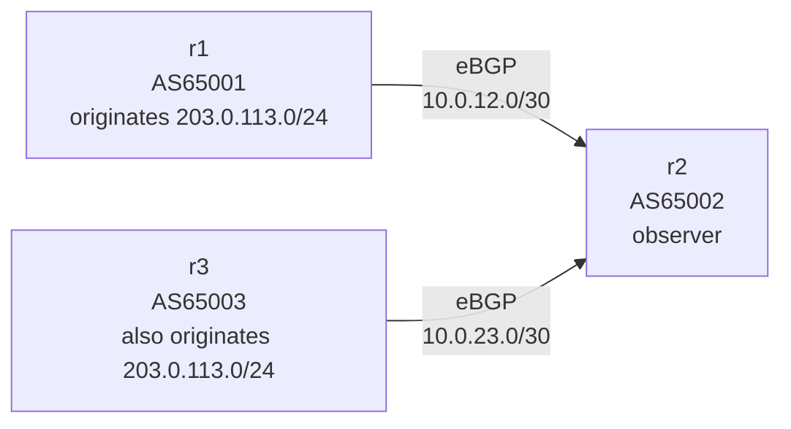
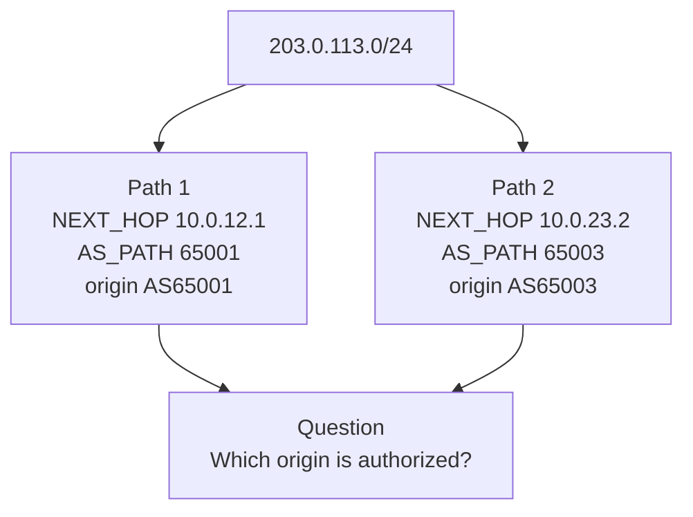

:::message
この記事は、ネットワークプロトコルを手を動かして学ぶフリー教材シリーズ **Protocol Lab** の一部です。トポロジ定義や検証スクリプトはすべてリポジトリで公開しています。
https://github.com/pathvector-studio/protocol-lab
:::

BGP Lab の第3回です。今回は**同じprefixを、2つの異なるASが広告する**状態を作ります。

テーマはシンプルです。

> BGPでprefixが見えていることと、誰がそのprefixをoriginateしてよいかを知っていることは、別の話である。

想定時間は45〜60分です。RFCの読みどころは次のガイドにまとめています。

- 読書ガイド: [bgp-rfc4271-lab03.md](https://github.com/pathvector-studio/protocol-lab/blob/main/rfc-notes/bgp-rfc4271-lab03.md)

## ゴール

2つのAS（AS65001とAS65003）に同じprefix `203.0.113.0/24` を広告させます。上流にあたる観察役のルータ `r2` から、1つのprefixに対して2本のpathが見える状態を作ります。

最終的に、次の観察結果を自分の言葉で説明できることを目指します。

```text
203.0.113.0/24 has two BGP paths on r2
path via 10.0.12.1 has origin AS65001
path via 10.0.23.2 has origin AS65003
```

あわせて、AS_PATH の右端にある origin AS を読み、competing origin（複数のoriginが競合している状態）がなぜ危険の入口になるのかを説明します。

## 学べること

- AS_PATH の右端にある AS が、その route の **origin AS** として読まれる。
- 同じ prefix が複数の origin AS から見えることがある。
- competing origin は、誤設定、意図したマルチホーム、route leak、hijack など、さまざまな理由で起きうる。
- BGP table を見ただけでは、その origin AS が本当に許可されているかは分からない。
- この問いに答える材料が RPKI origin validation で、次のLabで扱う。

このLabで扱わないもの:

- RPKI / ROA / ROV
- route leak の詳細な分類
- BGP decision process の詳細
- AS path validation
- 実インターネットへの経路広告

## RFCで読む場所

今回の必読は RFC 4271 の以下です。

| 章 | 読むポイント |
|---|---|
| 1.1 | AS、BGP speaker、route、RIB の用語 |
| 3.1 | route は prefix と path attributes の組であること |
| 4.3 | UPDATE message が path attributes と NLRI を運ぶこと |
| 5.1.2 | AS_PATH と AS_SEQUENCE |
| 9 | BGP speaker が受け取った UPDATE を処理し、route を保持・選択すること |

route leak の入口として、RFC 7908 の problem statement も合わせて読んでおくと理解が深まります。

## 実験の全体像

3台の仮想ルータを作ります。

```text
AS65001 / r1                         AS65002 / r2                         AS65003 / r3
10.0.12.1/30  ----------------------  10.0.12.2/30
                                      10.0.23.1/30  ----------------------  10.0.23.2/30

r1 advertises:
  203.0.113.0/24

r3 also advertises:
  203.0.113.0/24

r2 observes:
  203.0.113.0/24 via 10.0.12.1, AS_PATH 65001
  203.0.113.0/24 via 10.0.23.2, AS_PATH 65003
```

:::message
`203.0.113.0/24` は RFC 5737 で定められた documentation prefix です。Lab 内だけで使い、外部には広告しません。
:::



`r2` から見ると、1つのprefixに2本のpathがぶら下がっている状態です。



## 必要なもの

推奨環境:

- Linux / WSL2 / Linux VM
- Docker
- containerlab
- ホスト側の tcpdump
- Wireshark または tshark

使用イメージ:

- `frrouting/frr:latest`

:::message
macOS の場合は、Linux VM や WSL 相当の環境、または OrbStack / Colima 上の Linux VM で実行する想定です。
:::

## 実行手順

以下の手順は、containerlab を実行する Linux 環境の中で行います。

リポジトリを clone 済みなら、検証スクリプト一発でも実行できます。

```bash
./scripts/labctl.sh run bgp-03
```

[`labctl.sh`](https://github.com/pathvector-studio/protocol-lab/blob/main/scripts/labctl.sh) の `run bgp-03` は、topology の deploy、FRR の出力確認、pcap の取得、destroy までをまとめて行います。ここからは、同じことを手で1ステップずつ進めます。

### 1. 作業ディレクトリへ移動する

トポロジ定義は [examples/bgp-03](https://github.com/pathvector-studio/protocol-lab/tree/main/examples/bgp-03) にあります。

```bash
cd protocol-lab/examples/bgp-03
```

### 2. 起動する

```bash
sudo containerlab deploy -t bgp-03.clab.yml
```

起動したら、コンテナが作られていることを確認します。

```bash
docker ps --format "table {{.Names}}\t{{.Status}}"
```

確認ポイント:

- `clab-bgp-03-r1` が起動している
- `clab-bgp-03-r2` が起動している
- `clab-bgp-03-r3` が起動している

neighbor が Established になるまで数秒待ってから、BGP summary を見ます。

```bash
docker exec -it clab-bgp-03-r2 vtysh -c "show bgp summary"
```

観察ポイント:

- `r2` の local AS は `65002`
- neighbor `10.0.12.1` の AS は `65001`
- neighbor `10.0.23.2` の AS は `65003`
- どちらの neighbor からも prefix を受信している

### 3. r2 で同じ prefix の2本のpathを見る

```bash
docker exec -it clab-bgp-03-r2 vtysh -c "show bgp ipv4 unicast 203.0.113.0/24"
```

次のように読めれば成功です。

```text
Paths: (2 available, best #...)
  65001
    10.0.12.1 from 10.0.12.1 ...
      Origin IGP ...
  65003
    10.0.23.2 from 10.0.23.2 ...
      Origin IGP ...
```

FRRouting のバージョンや best path の選び方によって、表示順は変わることがあります。重要なのは、**同じ `203.0.113.0/24` に対して `65001` と `65003` の2つの origin AS が見えていること**です。

### 4. packet capture で2つの UPDATE を見る

別のターミナルを開き、containerlab を動かしている Linux 環境の中で、r2 側の network namespace を capture します。

```bash
sudo ip netns exec clab-bgp-03-r2 tcpdump -i any -nn -s 0 -w bgp-03-r2.pcap tcp port 179
```

capture を開始したまま、さらに別のターミナルで r2 の BGP session を張り直します。

```bash
docker exec -it clab-bgp-03-r2 vtysh -c "clear bgp *"
```

数秒待ってから、tcpdump を `Ctrl-C` で止めます。現在の作業ディレクトリに `bgp-03-r2.pcap` が残ります。これを Wireshark で開きましょう。

見る場所:

- `10.0.12.1 -> 10.0.12.2` の BGP UPDATE
  - `AS_PATH: 65001`
  - `NLRI: 203.0.113.0/24`
- `10.0.23.2 -> 10.0.23.1` の BGP UPDATE
  - `AS_PATH: 65003`
  - `NLRI: 203.0.113.0/24`

ポイントは3つです。

- prefix は同じ
- origin AS は違う
- BGP UPDATE だけでは、どちらが許可された origin なのかは分からない

## 期待出力

出力が完全に一致する必要はありません。以下のフィールドを読み取れることを重視してください。

### `show bgp summary`

`r2` 側で確認すること:

```text
Local AS number 65002
Neighbor        V         AS   ...   State/PfxRcd
10.0.12.1       4      65001   ...   1
10.0.23.2       4      65003   ...   1
```

### `show bgp ipv4 unicast 203.0.113.0/24`

`r2` 側で確認すること:

```text
Paths: (2 available, best #...)
  65001
    10.0.12.1 from 10.0.12.1 ...
      Origin IGP ...
  65003
    10.0.23.2 from 10.0.23.2 ...
      Origin IGP ...
```

見るポイント:

- `203.0.113.0/24` が2本のpathで見える
- 片方の AS_PATH は `65001`
- もう片方の AS_PATH は `65003`
- AS_PATH の右端が origin AS として読める

## なぜそう動くのか

`r1` は `AS65001` として `203.0.113.0/24` を originate します。`r3` も `AS65003` として、同じ `203.0.113.0/24` を originate します。

`r2` は2つの eBGP neighbor から、同じ NLRI を持つ UPDATE を受け取ります。どちらの UPDATE にも path attributes が付いていますが、AS_PATH はそれぞれ違います。

つまりこの時点で `r2` は、**「同じ prefix へ行ける」という2つの主張**を見ていることになります。BGP は best path を1つ選ぶかもしれません。ただ、ここで観察すべきなのは、同じ prefix に複数の origin AS が見えているという事実のほうです。

これが常に攻撃とは限りません。意図したマルチホームや移行作業でも、origin が複数になることはあります。一方で、誤広告、route leak、prefix hijack の入口にもなりえます。そして **BGP table だけでは、その origin AS が許可されているかを判断できません**。

## よくある誤解

- competing origin は、必ずしも hijack を意味しない。
- route leak と competing origin は同じ意味ではない。route leak は経路広告の伝播範囲や AS 間の関係性の問題で、competing origin は同じ prefix の origin AS が複数見える状態のことを指す。
- best path に選ばれなかった path も、観察する上では重要である。
- AS_PATH は「prefix を所有している証明」ではない。

:::message alert
このLabは閉じた Docker 環境の中だけで動かします。documentation prefix を実インターネットへ広告してはいけません。
:::

## 詰まりやすい点

### r2 に1本のpathしか見えない

まず、neighbor が2つとも Established になっているか確認します。

```bash
docker exec -it clab-bgp-03-r2 vtysh -c "show bgp summary"
```

`10.0.12.1` と `10.0.23.2` の両方が見えない場合は、interface address を確認します。

```bash
docker exec -it clab-bgp-03-r1 ip addr show eth1
docker exec -it clab-bgp-03-r2 ip addr show eth1
docker exec -it clab-bgp-03-r2 ip addr show eth2
docker exec -it clab-bgp-03-r3 ip addr show eth1
```

### r1 または r3 が prefix を広告しない

それぞれの loopback と FRR の設定を確認します。

```bash
docker exec -it clab-bgp-03-r1 ip addr show lo
docker exec -it clab-bgp-03-r3 ip addr show lo
docker exec -it clab-bgp-03-r1 vtysh -c "show running-config"
docker exec -it clab-bgp-03-r3 vtysh -c "show running-config"
```

:::message
FRRouting の `network 203.0.113.0/24` は、対応する prefix が routing table に存在するときにだけ広告されます。
:::

### pcap に片方の UPDATE しか見えない

capture を開始した**後に** BGP session を張り直してください。

```bash
docker exec -it clab-bgp-03-r2 vtysh -c "clear bgp *"
```

それでも片方しか見えない場合は、`r2` の namespace で `-i any` を指定して capture しているか確認します。

## 練習問題

1. `r2` で見える `203.0.113.0/24` の2つの AS_PATH は何か。
2. それぞれの origin AS はどれか。
3. 同じ prefix に複数の origin が見えることは、なぜ危険の入口になるのか。
4. competing origin と route leak は何が違うか。
5. BGP table だけでは「許可された origin」かどうかを判断できない理由を説明せよ。

## 後片付け

Lab を終えたら、containerlab の topology を破棄します。

```bash
sudo containerlab destroy -t bgp-03.clab.yml
```

コンテナが残っていないことを確認します。

```bash
docker ps --format "table {{.Names}}\t{{.Status}}" | grep clab-bgp-03 || true
```

pcap を残す場合は、リポジトリの `assets/bgp-03/` に移します。

```bash
mkdir -p ../../assets/bgp-03
cp bgp-03-r2.pcap ../../assets/bgp-03/
```

残さない場合は削除します。

```bash
rm -f bgp-03-r2.pcap
```

## 検証済みの実行ログ

参考として、2026-05-09 に実際に取得したログを載せます（`assets/bgp-03/runs/20260509T060606Z/run.log` より）。

検証結果の `verification.json` は次のとおりでした。

```json
{
  "lab": "bgp-03",
  "run_id": "20260509T060606Z",
  "status": "verified",
  "message": "BGP route 203.0.113.0/24 is visible on r2 from origin AS65001 and AS65003."
}
```

観察役の `r2` では、2つの eBGP neighbor がそれぞれ1つずつ prefix を広告しています。

```text
Neighbor        V         AS   MsgRcvd   MsgSent   TblVer  InQ OutQ  Up/Down State/PfxRcd   PfxSnt Desc
10.0.12.1       4      65001         4         4        0    0    0 00:00:01            1        1 N/A
10.0.23.2       4      65003         4         4        0    0    0 00:00:01            1        1 N/A
```

同じ `203.0.113.0/24` に対して、`r2` の BGP table には2本のpathが見えています。

```text
   Network          Next Hop            Metric LocPrf Weight Path
*> 203.0.113.0/24   10.0.12.1                0             0 65001 i
*                   10.0.23.2                0             0 65003 i

Displayed  1 routes and 2 total paths
```

2本のpathを比べると、AS_PATH の右端にある origin AS は次のように異なります。

| Next hop | AS_PATH | Origin AS | BGP table status |
|---|---:|---:|---|
| `10.0.12.1` | `65001` | `65001` | valid, best |
| `10.0.23.2` | `65003` | `65003` | valid |

詳細表示を見ると、FRRouting は `65001` 側を best path に選んでいます（タイブレークは Router ID）。

```text
BGP routing table entry for 203.0.113.0/24, version 1
Paths: (2 available, best #1, table default)
  Advertised to non peer-group peers:
  10.0.12.1 10.0.23.2
  65001
    10.0.12.1 from 10.0.12.1 (1.1.1.1)
      Origin IGP, metric 0, valid, external, best (Router ID)
      Last update: Sat May  9 06:06:09 2026
  65003
    10.0.23.2 from 10.0.23.2 (3.3.3.3)
      Origin IGP, metric 0, valid, external
      Last update: Sat May  9 06:06:09 2026
```

この実行では、`203.0.113.0/24` は `AS65001` と `AS65003` の両方から見えていて、`r2` は `AS65001` 由来の path を best に選びました。

ただし、**best path に選ばれたことは「許可された origin」であることの証明にはなりません**。両方とも `valid` と表示されていますが、これは BGP の処理上有効という意味で、origin の正当性とは別物です。どちらの origin AS が正当かを判断するには、次のLabで扱う ROA / VRP と origin validation が必要です。

## まとめ

- AS_PATH の右端の AS が origin AS として読まれる。
- 同じ prefix が複数の origin AS から見える competing origin は、BGP では普通に起こりうる。
- 原因はマルチホームや移行のような正当なものから、誤設定、route leak、hijack までさまざまある。
- BGP table も UPDATE も「その origin が許可されているか」は教えてくれない。

## 参考文献

- RFC 4271, Section 1.1: Definition of common BGP terms
- RFC 4271, Section 3.1: Routes, advertisement, and storage
- RFC 4271, Section 4.3: UPDATE Message Format
- RFC 4271, Section 5.1.2: AS_PATH
- RFC 4271, Section 9: UPDATE Message Handling
- RFC 5737, Section 3: Documentation address blocks（`203.0.113.0/24` を含む）
- RFC 7908: Problem Definition and Classification of BGP Route Leaks

---

## Protocol Lab について

この記事は **Protocol Lab** シリーズの BGP Lab #3 です。Lab の一覧、トポロジ定義、検証スクリプトはこちらにあります。

https://github.com/pathvector-studio/protocol-lab

役に立ったら、GitHub でスターをいただけると励みになります ⭐

### 次回予告

次の Lab では、今回残った「どちらの origin が許可されているのか？」という問いに答えます。RPKI の ROA / VRP と BGP route を照合し、origin AS が **valid / invalid / not found** になる理由を観察します。

予習として、次の RFC に目を通しておくのがおすすめです。

- RFC 6482: Route Origin Authorization (ROA)
- RFC 6811: BGP Prefix Origin Validation
- RFC 8210: RPKI to Router Protocol
